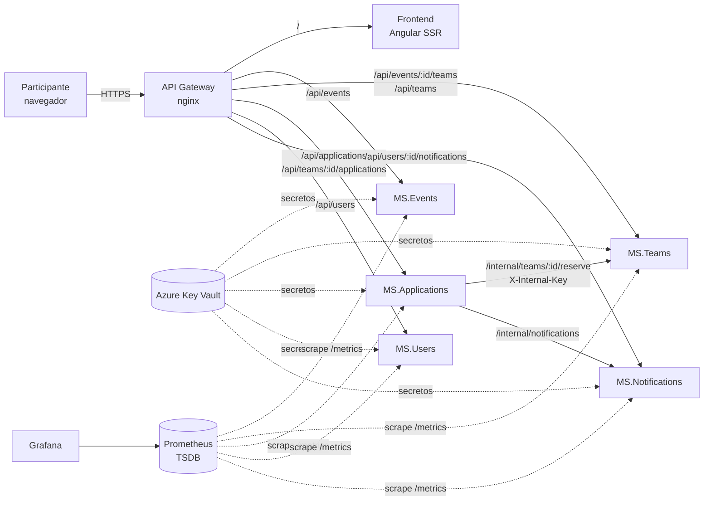
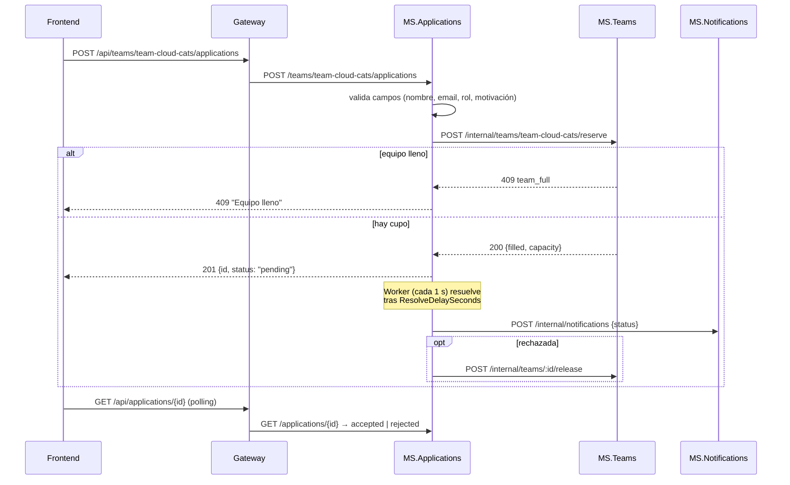

# 01 · Cómo funciona TeamForMe

TeamForMe es una plataforma de **eventos e ideas en búsqueda de grupo**: los participantes los descubren, ven los
grupos que se están formando (aforo, público/privado) y se **postulan** a uno. La postulación
se resuelve de forma asíncrona (pendiente → aceptada/rechazada) y genera una notificación.

## 1. Componentes del repositorio

| Carpeta | Qué es | Tecnología |
|---|---|---|
| `TeamForMeFrontend/` | Web del participante (SSR). Hoy consume una **capa mock** con firmas idénticas al backend (`environment.useMocks`). | Angular 21, signals, Express SSR, Leaflet, Tailwind 4 |
| `microservices/` | Backend real: **5 microservicios** + librería común. | .NET 10, ASP.NET Core Minimal APIs |
| `TeamForMeBackend/` | Plantilla gRPC original (servicio `Greeter`). Se conserva como base para la futura comunicación interna gRPC. | .NET 10, Grpc.AspNetCore |
| `gateway/` | API Gateway: punto de entrada único (`/api/*` → microservicio, `/` → frontend). | nginx |
| `observability/` | Prometheus (TSDB) + Grafana (visualización) con dashboard aprovisionado. | Prometheus 3, Grafana 12 |
| `k8s/ms-events/` | Módulo **MS.Events en Kubernetes** (HPA, VPA, PDB, Workload Identity). | Kustomize |
| `infra/` | Infraestructura como código para Azure. | Bicep |
| `scripts/azure/` | Despliegue, AKS y control de costos. | PowerShell + Azure CLI |

## 2. Arquitectura lógica

### Principios aplicados

- **Database per service (lógico):** cada microservicio es dueño de sus datos; nadie lee el
  almacén de otro, se comunican por HTTP.
- **API pública vs. API interna:** las rutas `/internal/*` solo se usan entre servicios, exigen la
  cabecera `X-Internal-Key` (secreto en Key Vault) y el gateway las bloquea hacia fuera.
- **Twelve-Factor:** configuración por variables de entorno/Key Vault, procesos sin estado
  donde es posible, logs a stdout, *disposability* (arranque rápido y apagado ordenado).
- **Observabilidad por defecto:** todos exponen `/metrics`, `/health/live`, `/health/ready` e `/info`.

## 3. Flujo principal: postularse a un equipo

La reserva de cupo es **atómica** (lock en `TeamStore.Reserve`), de modo que `filled` nunca
supera `capacity` aunque lleguen postulaciones concurrentes.

## 4. Contratos REST (resumen)

| Método y ruta pública (vía gateway) | Servicio | Respuesta |
|---|---|---|
| `GET /api/events` | MS.Events | `EventModel[]` |
| `GET /api/events/{id}` | MS.Events | `EventModel` / 404 |
| `GET /api/events/{eventId}/teams` | MS.Teams | `TeamModel[]` (privados sin `members`) |
| `GET /api/teams/{teamId}` | MS.Teams | `TeamModel` / 404 |
| `POST /api/teams/{teamId}/applications` | MS.Applications | 201 `ApplicationModel` / 400 / 404 / 409 |
| `POST /api/applications` | MS.Applications | igual, con `teamId` en el cuerpo |
| `GET /api/applications/{id}` | MS.Applications | `ApplicationModel` |
| `GET /api/users/me` | MS.Users | `UserModel` (cabecera opcional `X-User-Id`) |
| `GET /api/users/{id}` | MS.Users | `UserModel` / 404 |
| `GET /api/users/{userId}/notifications` | MS.Notifications | `NotificationModel[]` |

Los modelos JSON (camelCase) son **idénticos** a las interfaces de
`TeamForMeFrontend/src/app/core/models/*`, de modo que conectar el frontend consiste en poner
`useMocks: false` y `apiUrl: '/api'` e implementar el cuerpo `HttpClient` de cada servicio
(las firmas ya son las finales). Ver [contratos del frontend](../../TeamForMeFrontend/specs/001-hackathon-team-frontend/contracts/) y la [documentación del frontend](../../TeamForMeFrontend/docs/README.md).

## 5. Topologías de ejecución

| Entorno | Orquestador | Cómo se levanta |
|---|---|---|
| Local | Docker Compose | `docker compose up -d --build` |
| Azure PaaS (principal) | Azure Container Apps | `scripts/azure/deploy.ps1` |
| Azure Kubernetes (módulo MS.Events) | AKS | `deploy.ps1 -WithAks` + `deploy-aks.ps1` |
| Azure IaaS | VM Ubuntu + Docker Compose | `deploy.ps1 -WithVm` |

Detalle en la [guía de despliegue](despliegue/GUIA-AZURE-STUDENTS.md).
