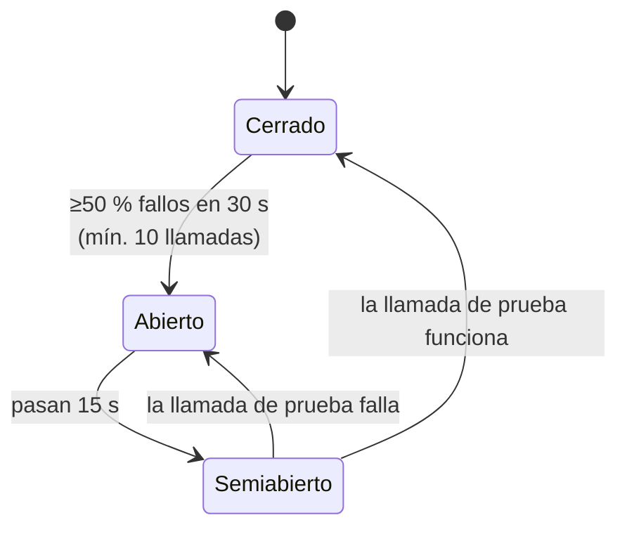

# 4 · Resiliencia y limitación de tasa

Dos familias de algoritmos que protegen el sistema: el **token bucket** frena a un cliente que
envía demasiado, y el **backoff exponencial** con el **circuit breaker** evita que un servicio caído
arrastre a los que dependen de él.

---

## 4a · Token Bucket (limitación de tasa)
Código: [`Algorithms/TokenBucket.cs`](../../src/TeamForMe.Shared/Algorithms/TokenBucket.cs) ·
Middleware: [`RateLimiting.cs`](../../src/TeamForMe.Shared/RateLimiting.cs)

### Algoritmo
Cada cliente tiene una cubeta con capacidad **C** (la ráfaga permitida) que se rellena a **r**
fichas por segundo. Cada petición consume una ficha:

```text
tokens(t) = min(C, tokens(t0) + r · (t − t0))      ← relleno perezoso, solo al consultar
permitir  ⇔ tokens(t) ≥ 1
si no     → 429 Too Many Requests,  Retry-After = ⌈(1 − tokens) / r⌉
```

```csharp
public TokenBucketResult TryTake(double cost = 1)
{
    lock (_gate)
    {
        Refill();                                   // tokens = min(C, tokens + Δt·r)
        if (_tokens >= cost) { _tokens -= cost; return new(true, _tokens, TimeSpan.Zero); }
        var retryAfter = TimeSpan.FromSeconds((cost - _tokens) / RefillPerSecond);
        return new(false, _tokens, retryAfter);
    }
}
```
- **O(1)** en tiempo y memoria por cliente: solo guarda dos números (fichas y último relleno), sin historial.
- A diferencia de una ventana fija, admite ráfagas cortas legítimas (hasta C) y aun así acota la tasa sostenida a r.

### Integración
| Aspecto | Decisión |
|---|---|
| Clave del cliente | Primera IP de `X-Forwarded-For` (la pone el ingress de Azure), si no la IP de conexión |
| Parámetros en Azure | `RateLimit__Capacity=100`, `RateLimit__RefillPerSecond=50` (Bicep) |
| Respuesta | `429` + `Retry-After` + `X-RateLimit-Limit` / `X-RateLimit-Remaining` |
| Exentos | `/health`, `/metrics`, `/info`, `/internal` y endpoints con `.SkipTokenBucketRateLimit()` |
| Memoria | Las cubetas inactivas más de 2 min se eliminan (barrido cada 1 000 peticiones) |
| Métrica | `teamforme_rate_limit_decisions_total{result="allowed\|limited"}` en `/metrics` |
| Limitación conocida | El estado es por réplica: con N réplicas el límite efectivo es ≈ N·r. Un límite global exacto requeriría Redis |

### Resultado (ráfaga de 300 peticiones simultáneas, en local)
```text
[burst] 300 peticiones simultáneas → http://localhost:5099/events
Peticiones: 300 en 0.2 s | OK 105 | errores 0
Códigos HTTP: 200=105  429=195
Retry-After recibido: 1 s
```
Pasan 100 (la ráfaga C) más ~5 rellenadas durante los 0,2 s (r·Δt = 50 × 0,1); las demás reciben
429. En Azure: [`evidencias/03-rate-limiting.txt`](evidencias/03-rate-limiting.txt).

---

## 4b · Backoff exponencial con jitter y circuit breaker
Código: [`Resilience.cs`](../../src/TeamForMe.Shared/Resilience.cs). Se aplica a los clientes HTTP
de `ms-applications` hacia `ms-teams` y `ms-notifications`, y al cliente `lab-flaky` de la demo.

### Pipeline (de fuera hacia dentro)
```text
Timeout total 15 s
 └─ Reintento: 3 intentos, backoff exponencial + jitter      espera ≈ 200 ms · 2ⁿ ± aleatorio
     └─ Circuit breaker: ≥50 % de fallos en 30 s (mín. 10 llamadas) → abierto 15 s
         └─ Timeout por intento 3 s
```

### Backoff exponencial con jitter
| Intento fallido | Espera base | Con jitter (ejemplo real del log) |
|---|---|---|
| 1 | 200 ms | 152 ms, 62 ms, 256 ms |
| 2 | 400 ms | 303 ms, 122 ms |
| 3 | 800 ms | … |

- **Exponencial:** duplicar la espera le da tiempo de recuperarse a un servicio saturado.
- **Jitter:** si 10 réplicas fallan a la vez y todas esperan exactamente 200 ms, reintentan
  sincronizadas y vuelven a tumbar el servicio. El componente aleatorio las desincroniza.
- No se reintentan POST, PUT, PATCH ni DELETE (`DisableForUnsafeHttpMethods`) porque no son idempotentes.

### Circuit breaker (máquina de estados)

Mientras está **abierto**, las llamadas fallan en ~0 ms sin tocar la red (*fail fast*). Así no se
acumulan hilos esperando timeouts, ni se insiste sobre un servicio caído.

```csharp
o.CircuitBreaker.FailureRatio = 0.5;
o.CircuitBreaker.MinimumThroughput = 10;
o.CircuitBreaker.SamplingDuration = TimeSpan.FromSeconds(30);
o.CircuitBreaker.BreakDuration = TimeSpan.FromSeconds(15);
o.CircuitBreaker.OnOpened = args => { CircuitState.WithLabels(clientName).Set(2); logger.LogError(...); ... };
```
Observabilidad: la métrica `teamforme_circuit_breaker_state` (0 cerrado, 1 semiabierto, 2 abierto),
`teamforme_http_retries_total`, y los logs `Reintento N …` / `Circuit breaker ABIERTO …` en Log Analytics.

### Resultado (`/api/lab/resilience?failureRate=0.8&calls=25&pauseMs=1000`, en local)
| Llamada | Segundo | Resultado | Intentos de red | Duración |
|---|---|---|---|---|
| 1 | 1,2 | HTTP 200 (tras 3 reintentos) | 4 | 1 189 ms |
| 2 | 2,6 | HTTP 200 (tras 2 reintentos) | 3 | 399 ms |
| 4 | 5,0 | circuito **ABIERTO** | 2 | 388 ms |
| 5–18 | 6–19 | circuito ABIERTO (fail fast) | **0** | **0–1 ms** |
| 19 | 20,3 | **semiabierto**: 1 llamada de prueba, falla → abierto otra vez | 1 | 205 ms |
| 20–25 | 21–26 | circuito ABIERTO (fail fast) | 0 | 0 ms |

En Azure: [`evidencias/04-resiliencia.txt`](evidencias/04-resiliencia.txt).

## Capturas para la presentación
1. Terminal: salida de la ráfaga con `429` y `Retry-After`.
2. Navegador: JSON de `/api/lab/resilience` con la transición *HTTP 200 → ABIERTO → prueba semiabierta*.
3. Portal → `ms-events` → **Logs** (Log Analytics), con la consulta:
   ```kusto
   ContainerAppConsoleLogs_CL
   | where ContainerAppName_s == "ms-events"
   | where Log_s has_any ("Reintento", "Circuit breaker", "Rate limit")
   | project TimeGenerated, RevisionName_s, Log_s
   | order by TimeGenerated desc
   ```
