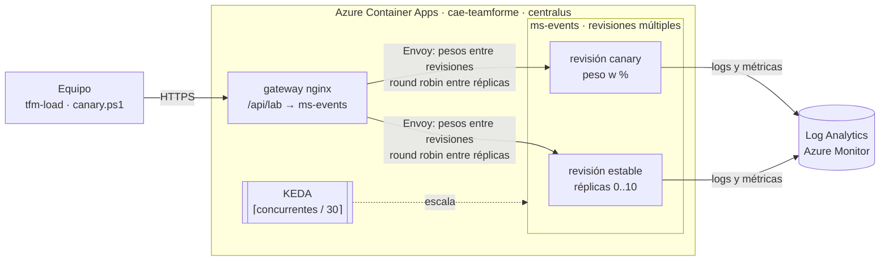

# Algoritmos de infraestructura · TeamForMe en Azure

Este documento resume los algoritmos de infraestructura que se aplicaron al lanzar TeamForMe en
**Azure Container Apps** (suscripción Azure for Students, región `centralus`). Para cada uno se
indica dónde está **implementado en código**, cómo se **configura en Azure** y qué **evidencia**
lo demuestra.

| # | Algoritmo | Implementación en código | Configuración en Azure | Evidencia |
|---|---|---|---|---|
| 1 | **Balanceo de carga**: Round Robin, Smooth Weighted RR, Least Connections, Power of Two Choices | [`Algorithms/LoadBalancing.cs`](../../src/TeamForMe.Shared/Algorithms/LoadBalancing.cs), [`LoadBalancingSimulator.cs`](../../src/TeamForMe.Shared/Algorithms/LoadBalancingSimulator.cs) | Envoy (ingress de Container Apps) hace round robin entre réplicas; reparto por pesos entre revisiones | [01](01-balanceo-de-carga.md) · [`evidencias/01`](evidencias/01-balanceo-de-carga.txt) |
| 2 | **Autoescalado horizontal** (algoritmo HPA / KEDA) | [`Algorithms/HorizontalAutoscaler.cs`](../../src/TeamForMe.Shared/Algorithms/HorizontalAutoscaler.cs) | Regla KEDA `http-concurrency` (30 concurrentes/réplica, 0–10 réplicas) en [`containerapps.bicep`](../../../infra/modules/containerapps.bicep) | [02](02-autoescalado.md) · [`evidencias/02`](evidencias/02-autoescalado.txt) |
| 3 | **Despliegue progresivo canary / blue-green** con rollback automático | [`scripts/azure/canary.ps1`](../../../scripts/azure/canary.ps1), [`ChaosInjection.cs`](../../src/TeamForMe.Shared/ChaosInjection.cs) | `activeRevisionsMode: Multiple` + pesos de tráfico por revisión | [03](03-despliegue-canary.md) · [`evidencias/05`](evidencias/05-canary.txt) · [`evidencias/06`](evidencias/06-canary-rollback.txt) |
| 4a | **Limitación de tasa con token bucket** | [`Algorithms/TokenBucket.cs`](../../src/TeamForMe.Shared/Algorithms/TokenBucket.cs), [`RateLimiting.cs`](../../src/TeamForMe.Shared/RateLimiting.cs) | `RateLimit__Capacity=100`, `RateLimit__RefillPerSecond=50` | [04](04-resiliencia-y-rate-limiting.md) · [`evidencias/03`](evidencias/03-rate-limiting.txt) |
| 4b | **Backoff exponencial con jitter y circuit breaker** | [`Resilience.cs`](../../src/TeamForMe.Shared/Resilience.cs) (Polly v8) | Variables por defecto; eventos en Log Analytics | [04](04-resiliencia-y-rate-limiting.md) · [`evidencias/04`](evidencias/04-resiliencia.txt) |

## Arquitectura de la demostración

## Cómo se ejecuta

| Paso | Comando | Resultado |
|---|---|---|
| Pruebas unitarias de los algoritmos | `dotnet test microservices/tests/TeamForMe.Algorithms.Tests` | 12 pruebas en verde |
| Despliegue | `./scripts/azure/deploy.ps1 -ResourceLocation centralus -UseAcrBuild` | URLs del gateway y Grafana |
| Demostraciones 1, 2 y 4 | `./scripts/azure/demo-algoritmos.ps1` | Archivos en `evidencias/` |
| Canary exitoso | `./scripts/azure/canary.ps1 -Version v2` | Promoción 10 → 50 → 100 % |
| Canary con rollback | `./scripts/azure/canary.ps1 -Version v3 -SimulateFailure` | Rollback automático |

Endpoints del laboratorio (a través del gateway, `https://<gateway>/api/lab/...`):

| Endpoint | Qué hace |
|---|---|
| `GET /api/lab/load-balancing?requests=5000&rate=80` | Compara los 4 algoritmos de balanceo con las mismas peticiones |
| `GET /api/lab/load-balancing/sequence?weights=5,1,1` | Orden de elección del Smooth Weighted Round Robin |
| `GET /api/lab/autoscaler?profile=spike\|ramp\|noisy` | Línea de tiempo del algoritmo HPA/KEDA |
| `GET /api/lab/work?ms=2000` | Retiene la petición para generar concurrencia real (dispara KEDA) |
| `GET /api/lab/resilience?failureRate=0.8&calls=24&pauseMs=1000` | Reintentos y estados del circuit breaker |
| `GET /api/events/_info` | Réplica y versión que atendió (balanceo real y canary) |

## Guía de la presentación
El guion, el orden de la demo y la lista de capturas del portal de Azure están en
[GUIA-PRESENTACION.md](GUIA-PRESENTACION.md).
