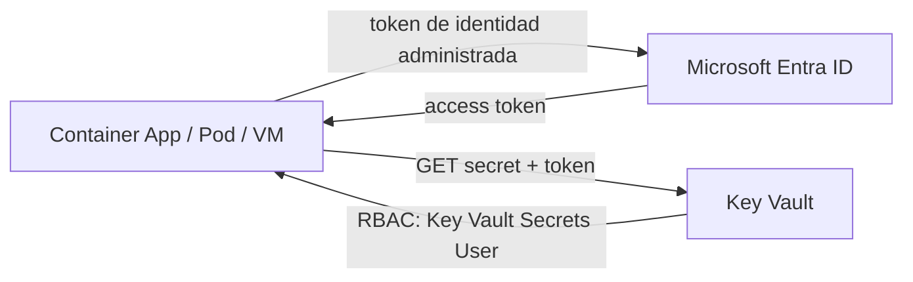

# 01 · Asignación eficiente de recursos en la nube y Azure Key Vault

## 1. El problema

Asignar recursos es decidir **cuánta CPU, memoria, red y almacenamiento recibe cada carga, en
qué máquina corre y cuándo**. Asignar de más desperdicia dinero; asignar de menos degrada la
latencia o tumba el servicio. En la nube el recurso se paga por uso, así que asignar bien es
también una decisión económica.

## 2. Estrategias

| Estrategia | Idea | Dónde se aplica en TeamForMe |
|---|---|---|
| **Reserva + límite** (requests/limits) | Piso garantizado y techo duro por contenedor | `deploy.resources` en `docker-compose.yml`; `resources` en `k8s/ms-events/base/deployment.yaml`; `cpu/memory` en `containerapps.bicep` |
| **Right-sizing** | Ajustar la asignación al consumo real medido | VPA en modo recomendación (`k8s/ms-events/tools/vpa.yaml`) + paneles de CPU/memoria en Grafana |
| **Autoescalado reactivo** | Añadir/quitar réplicas según una métrica | HPA (CPU/memoria), reglas HTTP de KEDA en Container Apps, autoscale de VMSS |
| **Scale to zero** | Sin tráfico, cero réplicas y cero costo de cómputo | `minReplicas: 0` en ms-events, ms-users, frontend |
| **Bin packing** | Empaquetar cargas en el menor número de nodos | Scheduler de Kubernetes con requests pequeños; `expander: least-waste` del Cluster Autoscaler |
| **Spread / anti-afinidad** | Repartir réplicas entre nodos para tolerar fallos | `topologySpreadConstraints` en el Deployment |
| **Separación con/sin estado** | Solo lo que no tiene estado se replica libremente | Events/Users horizontales; Teams/Applications/Notifications fijos en 1 |
| **Cuotas y topes de gasto** | Evitar que un error consuma todo el crédito | `dailyQuotaGb: 0.5` en Log Analytics, `maxReplicas` en cada app, `scripts/azure/costs.ps1` |
| **Tiers gratuitos** | Usar lo que no se cobra | Plano de control AKS *Free*, grant mensual de Container Apps, VM B1s (750 h) |

## 3. Algoritmos

### 3.1 Planificación (scheduling) de contenedores
El scheduler de Kubernetes funciona en dos fases:

1. **Filtrado:** descarta nodos sin recursos libres suficientes para los `requests`, con *taints*
   incompatibles, etc.
2. **Puntuación:** ordena los nodos restantes. `LeastAllocated` favorece nodos vacíos (spread);
   `MostAllocated` favorece nodos llenos (bin packing, menos nodos y menos costo).

Es una variante del problema **bin packing** (NP-difícil), que se resuelve con heurísticas:

| Heurística | Regla | Efecto |
|---|---|---|
| *First Fit* | primer nodo donde cabe | rápida |
| *Best Fit* | el nodo que queda con menos hueco | menos fragmentación, menos nodos |
| *Worst Fit* | el nodo con más hueco | reparte la carga |

### 3.2 Autoescalado horizontal (HPA)
```
réplicasDeseadas = ceil( réplicasActuales × métricaActual / métricaObjetivo )
```
Con una tolerancia del 10 % para no reaccionar a ruido, y ventanas de estabilización para no
oscilar. En `hpa.yaml` el scale-up es agresivo (puede duplicar cada 15 s) y el scale-down es
conservador (1 pod por minuto tras 120 s estable).

### 3.3 Autoescalado por eventos (KEDA, usado por Container Apps)
```
réplicas = ceil( peticionesConcurrentes / 30 )      # regla http-concurrency
```
Activa la app desde 0 al llegar la primera petición y la vuelve a 0 tras unos 5 minutos sin tráfico.

### 3.4 Umbrales con enfriamiento (VMSS)
`CPU media > 70 % durante 5 min → +1 VM`; `< 30 % durante 10 min → −1 VM`; *cooldown* de 5 min.
Que los umbrales sean asimétricos (histéresis) evita el *flapping*.

### 3.5 Balanceo de carga
- **Round robin:** Envoy en Container Apps y kube-proxy (aproximado) en Kubernetes.
- **Least connections / EWMA:** opción de nginx y de Envoy para cargas heterogéneas.
- **Health-aware:** solo reciben tráfico las réplicas que pasan `/health/ready`.

## 4. Características de una buena asignación
Elasticidad, medición (no se ajusta lo que no se mide), aislamiento (los `limits` impiden que un
vecino ruidoso afecte a otros), auto-reparación (*probes* + reinicio), mínimo privilegio y
trazabilidad del costo (etiquetas `project=teamforme` en el grupo de recursos).

### Clases de calidad de servicio (QoS) en Kubernetes
| Clase | Condición | Prioridad ante falta de memoria |
|---|---|---|
| Guaranteed | requests = limits | última en ser expulsada |
| **Burstable** (ms-events) | requests < limits | intermedia |
| BestEffort | sin requests ni limits | primera en ser expulsada |

---

## 5. Implementación: Azure Key Vault

### 5.1 Qué resuelve
Los secretos (claves, contraseñas, cadenas de conexión) **no** viven en el código, en la imagen
Docker, en `appsettings.json` ni en variables de entorno escritas a mano. Se centralizan en
Key Vault, con control de acceso RBAC, auditoría, versionado y *soft delete*.

### 5.2 Secretos de TeamForMe
| Secreto en Key Vault | Clave .NET | Quién lo usa | Cómo llega |
|---|---|---|---|
| `Internal--ApiKey` | `Internal:ApiKey` | Los 5 microservicios (autenticación servicio a servicio) | **SDK** en la app (`KeyVaultConfiguration.cs`) |
| `grafana-admin-password` | — | Grafana | **Referencia de la plataforma** (secret de Container Apps con `keyVaultUrl`) |

Se muestran dos patrones de consumo:

1. **Desde la aplicación (SDK):** `builder.Configuration.AddAzureKeyVault(uri, new DefaultAzureCredential())`.
   La app lee el vault al arrancar y cada 5 minutos (rotación sin reinicio).
2. **Desde la plataforma:** Container Apps resuelve el secreto y lo inyecta como variable de
   entorno. La app (Grafana) no sabe que existe Key Vault.

En AKS el patrón es el 1 con **Workload Identity**. La alternativa sería el *Secrets Store CSI
Driver*, que monta los secretos como archivos.

### 5.3 Identidad sin contraseñas

- `infra/modules/identity.bicep`: una **identidad administrada asignada por el usuario** (`id-teamforme`).
- `infra/modules/keyvault.bicep`: el vault usa `enableRbacAuthorization: true`. La identidad recibe
  **Key Vault Secrets User** (solo lectura) y quien despliega recibe **Key Vault Secrets Officer**
  para ver y rotar secretos en el portal.
- `infra/modules/aks.bicep`: una *federated identity credential* que confía en el ServiceAccount
  `teamforme/ms-events`.

### 5.4 Configuración por entorno
| Entorno | `KeyVault__Uri` | Origen de `Internal:ApiKey` |
|---|---|---|
| Local (compose) | vacío | `.env` → `INTERNAL_API_KEY` |
| Local con vault real | URI del vault + `az login` | Key Vault (credencial Azure CLI) |
| Container Apps | `https://kv-teamforme-xxxx.vault.azure.net/` | Key Vault (Managed Identity) |
| AKS | igual | Key Vault (Workload Identity) |

### 5.5 Rotar un secreto
```bash
az keyvault secret set --vault-name <kv> --name Internal--ApiKey --value <nuevo-valor>
```
En ≤ 5 minutos todos los servicios recargan el valor. Para un corte inmediato:
`az containerapp revision restart`. La versión anterior queda en el historial del secreto.

### 5.6 Verificación
```bash
curl https://<gateway>/api/events          # funciona
curl https://<gateway>/api/events/_info    # -> "keyVault": true, "instance": "ms-events--abc123-..."
```
Llamar a `/internal/...` sin la clave devuelve **401**; a través del gateway devuelve **404**.
