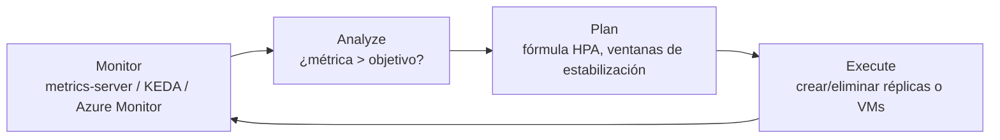

# 03 · Adaptabilidad, eficiencia y otras propiedades en la nube

| Propiedad | Definición | Cómo se logra en TeamForMe |
|---|---|---|
| **Adaptabilidad** | El sistema reacciona a cambios de carga, fallos o configuración sin intervención humana | Autoescalado (HPA/KEDA/VMSS), *probes* con reinicio, resiliencia HTTP, recarga de secretos |
| **Eficiencia** | Máximo trabajo útil por unidad de recurso y de costo | Scale to zero, right-sizing (VPA), imágenes pequeñas, GC ajustado, tiers gratuitos |
| **Disponibilidad** | Proporción de tiempo en que el servicio responde | Réplicas, PDB, rolling updates, *readiness* |
| **Resiliencia** | Tolerar fallos parciales y degradarse con control | Circuit breaker, timeouts, reintentos con jitter, fallo aislado por microservicio |
| **Observabilidad** | Inferir el estado interno desde fuera | Métricas Prometheus, logs a Log Analytics, `/info`, alertas |
| **Portabilidad** | Mover la carga entre entornos sin reescribirla | Contenedores OCI: el mismo artefacto corre en compose, ACA, AKS y VM |
| **Seguridad** | Confidencialidad e integridad | Key Vault, identidades administradas, `/internal` protegido, contenedores no-root y FS de solo lectura |

## 1. Adaptabilidad

### 1.1 Ante cambios de carga
Ver [escalabilidad y elasticidad](02-escalabilidad-y-elasticidad.md). El ciclo es un lazo de
control **MAPE-K** (Monitor → Analyze → Plan → Execute sobre una base de conocimiento):

### 1.2 Ante fallos
| Mecanismo | Dónde | Efecto |
|---|---|---|
| `livenessProbe` → reinicio | Deployment, Container Apps | Auto-reparación de procesos colgados |
| `readinessProbe` → fuera del balanceo | Deployment, Container Apps | No se envía tráfico a réplicas que no están listas |
| `startupProbe` | Deployment | No mata réplicas lentas al arrancar |
| `restart: unless-stopped` | compose | Reinicio automático en local/VM |
| Circuit breaker + timeout | `MS.Applications` (`AddStandardResilienceHandler`) | Si MS.Teams cae, se falla rápido en lugar de acumular hilos |
| Reintentos con backoff + jitter | igual (solo GET) | Absorbe errores transitorios sin efecto rebaño |
| Fallo aislado | Arquitectura | Si MS.Notifications cae, las postulaciones se siguen resolviendo (solo se pierde el aviso, que queda en el log) |

### 1.3 Ante cambios de configuración
- Secretos de Key Vault recargados cada 5 minutos (`ReloadInterval`).
- Nuevas revisiones de Container Apps con `activeRevisionsMode: Single`: el despliegue es
  atómico y reversible (`az containerapp revision activate`).
- Gateway configurable por variables (`*_UPSTREAM`): la misma imagen sirve para compose y Azure.

## 2. Eficiencia

### 2.1 Eficiencia de cómputo
| Técnica | Impacto |
|---|---|
| Dockerfile multi-stage (SDK solo en build) | Imagen ~220 MB en lugar de ~900 MB → pull y arranque más rápidos |
| `ServerGarbageCollection=false` | Menos memoria por réplica, más réplicas por nodo |
| `DOTNET_gcHeapHardLimitPercent=75 %` | El GC respeta el límite del contenedor (evita OOMKilled) |
| `InvariantGlobalization` | Sin ICU, menos memoria |
| Minimal APIs | Menos capas que MVC, menor latencia |
| `requests` pequeños + `limits` holgados | Bin packing denso con capacidad de ráfaga |

### 2.2 Eficiencia de costo (FinOps)
| Práctica | Implementación |
|---|---|
| Pagar solo por uso | Container Apps Consumption con scale to zero |
| Aprovechar el grant gratuito | ACA incluye 180 000 vCPU-s, 360 000 GiB-s y 2 M de peticiones al mes |
| Plano de control gratuito | AKS tier *Free* |
| VM gratis | B1s (750 h/mes durante 12 meses en Azure for Students) + discos P6 |
| Tope de ingesta de logs | `dailyQuotaGb: 0.5` |
| Apagar lo que no se usa | `scripts/azure/costs.ps1 -Action Pause` (AKS stop, VM deallocate, ACA min 0) |
| Etiquetado | `project=teamforme environment=student` para filtrar en Cost Management |
| Presupuesto con alertas | Guía de despliegue, paso de *budget* |

### 2.3 Eficiencia energética
Consolidar cargas (bin packing) y apagar recursos ociosos (scale to zero, deallocate) reduce la
energía consumida. Azure publica la huella de carbono por suscripción en *Emissions Impact Dashboard*.

## 3. Otras características de la nube (NIST SP 800-145)
| Característica | Ejemplo en TeamForMe |
|---|---|
| Autoservicio bajo demanda | `deploy.ps1` crea todo sin intervención del proveedor |
| Acceso amplio por red | Gateway HTTPS público |
| Pool de recursos (multi-tenancy) | Container Apps comparte nodos administrados entre clientes |
| Elasticidad rápida | KEDA 0 → N en segundos |
| Servicio medido | Facturación por vCPU-segundo y GiB-segundo; métricas en Azure Monitor |
