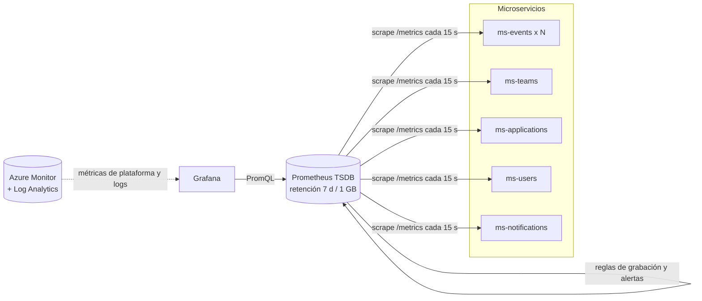

# 04 · Bases de datos de series temporales y visualización de métricas

## 1. ¿Qué es una base de datos de series temporales (TSDB)?
Una TSDB está optimizada para guardar y consultar **secuencias de valores indexados por tiempo**:
`(métrica, etiquetas, timestamp, valor)`. Ejemplo:

```text
http_requests_received_total{job="ms-events", code="200", method="GET"}  1729850000  1532
http_requests_received_total{job="ms-events", code="200", method="GET"}  1729850015  1547
```

### En qué se diferencia de una base relacional
| Aspecto | TSDB | Base relacional |
|---|---|---|
| Escritura | Append-only, cientos de miles de puntos/s | Transacciones con actualizaciones |
| Compresión | Delta-of-delta en timestamps y XOR (Gorilla) en valores: ~1,3 bytes/muestra | Filas completas |
| Consultas | Rangos de tiempo, agregaciones, `rate`, percentiles | Joins arbitrarios |
| Ciclo de vida | Retención y *downsampling* automáticos | Manual |
| Cardinalidad | Crítica: cada combinación de etiquetas es una serie | No aplica |

### TSDB más conocidas
| TSDB | Modelo | Lenguaje | Nota |
|---|---|---|---|
| **Prometheus** (usada aquí) | Pull (scrape) | PromQL | Estándar de facto en Kubernetes (CNCF) |
| InfluxDB | Push | Flux / InfluxQL / SQL | Fuerte en IoT |
| TimescaleDB | Extensión de PostgreSQL | SQL | Series temporales con joins relacionales |
| VictoriaMetrics / Thanos / Mimir | Compatibles con Prometheus | PromQL | Almacenamiento a largo plazo y alta escala |
| **Azure Monitor Metrics** | Administrada | KQL / PromQL (Managed Prometheus) | Integrada con todos los recursos de Azure |
| Azure Data Explorer | Columnar | KQL | Analítica de telemetría masiva |

## 2. Implementación en TeamForMe



### 2.1 Exposición (instrumentación)
`prometheus-net` publica tres familias de métricas en `/metrics`:

| Familia | Ejemplos | Origen |
|---|---|---|
| HTTP | `http_requests_received_total`, `http_request_duration_seconds_bucket` | `app.UseHttpMetrics()` |
| Proceso/.NET | `process_cpu_seconds_total`, `process_working_set_bytes`, `dotnet_total_memory_bytes` | Automáticas |
| **Negocio** | `teamforme_team_seats_filled`, `teamforme_applications_pending`, `teamforme_applications_resolved_total{status}`, `teamforme_notifications_created_total{type}` | Código de cada servicio |

Tipos usados: **counter** (solo crece: peticiones, postulaciones), **gauge** (sube y baja: cupos,
cola), **histogram** (distribución de latencias en *buckets*, permite calcular percentiles).

### 2.2 Recolección y almacenamiento
- `observability/prometheus/prometheus.yml`: un job por microservicio con `dns_sd_configs`, que
  descubre **todas las réplicas**. Escalar a 4 réplicas añade 4 *targets* sin tocar la configuración.
- Retención: `--storage.tsdb.retention.time=7d` y `--storage.tsdb.retention.size=1GB`.
- Bloques de 2 h en disco + WAL (write-ahead log) para no perder datos ante un reinicio.

### 2.3 Reglas (`observability/prometheus/rules.yml`)
| Tipo | Nombre | Expresión |
|---|---|---|
| Grabación | `job:http_requests:rate1m` | `sum by (job) (rate(http_requests_received_total[1m]))` |
| Grabación | `job:http_request_duration_seconds:p95_5m` | `histogram_quantile(0.95, …)` |
| Grabación | `team:occupancy:ratio` | `filled / capacity` |
| Alerta | `ServicioCaido` | `up{job=~"ms-.*"} == 0` durante 1 min |
| Alerta | `LatenciaAlta` | p95 > 500 ms durante 5 min |
| Alerta | `ColaDePostulacionesCreciendo` | pendientes > 50 durante 2 min |

### 2.4 Consultas PromQL útiles
```promql
# Peticiones por segundo por servicio
sum by (job) (rate(http_requests_received_total[1m]))

# Latencia p95
histogram_quantile(0.95, sum by (le, job) (rate(http_request_duration_seconds_bucket[5m])))

# Tasa de errores 5xx
sum(rate(http_requests_received_total{code=~"5.."}[5m])) / sum(rate(http_requests_received_total[5m]))

# Réplicas vivas por servicio (refleja el autoescalado)
count by (job) (up{job=~"ms-.*"} == 1)

# Equipos casi llenos
teamforme_team_seats_filled / teamforme_team_seats_capacity > 0.8
```

## 3. Visualización de métricas (Grafana)

Dashboard aprovisionado como código: `observability/grafana/dashboards/teamforme-overview.json`
(carpeta *TeamForMe*, también es la página de inicio).

| Panel | Tipo | Pregunta que responde |
|---|---|---|
| Réplicas activas por servicio | Stat | ¿Escaló? ¿Hay alguna réplica caída? |
| Peticiones/s (total) | Stat | ¿Cuánta carga hay ahora? |
| Postulaciones pendientes | Stat | ¿Se está acumulando trabajo? |
| Errores 5xx/s | Stat con umbral rojo | ¿Hay fallos? |
| Peticiones por segundo por servicio | Serie temporal | ¿Qué servicio recibe la carga? |
| Latencia p95 por servicio | Serie temporal | ¿Se degrada la experiencia? |
| CPU por réplica | Serie temporal | ¿Se reparte la carga? ¿Está bien dimensionado? |
| Memoria por réplica | Serie temporal | ¿Fugas? ¿Límites adecuados? |
| Ocupación de equipos | Bar gauge (verde/naranja/rojo) | Métrica de negocio |
| Postulaciones creadas y resueltas | Serie temporal | Flujo de negocio end-to-end |

Buenas prácticas aplicadas: método **RED** (Rate, Errors, Duration) para servicios, **USE**
(Utilization, Saturation, Errors) para recursos, unidades explícitas, umbrales de color y
refresco cada 10 s.

### Acceso
| Entorno | URL | Credenciales |
|---|---|---|
| Local | http://localhost:3000 | `admin` / `GRAFANA_ADMIN_PASSWORD` de `.env` (por defecto `admin`) |
| Azure | salida `grafanaUrl` de `deploy.ps1` | `admin` / secreto `grafana-admin-password` de Key Vault |

```bash
az keyvault secret show --vault-name <kv> -n grafana-admin-password --query value -o tsv
```

## 4. Métricas en Azure (TSDB administrada)
- **Azure Monitor Metrics:** Container Apps publica `Requests`, `Replicas`, `UsageNanoCores`,
  `WorkingSetBytes` sin instrumentar nada. Se ven en *Portal → Container App → Metrics*. Grafana
  puede consultarlas con el datasource *Azure Monitor* (requiere el rol *Monitoring Reader*).
- **Log Analytics (KQL):** los logs de consola llegan a `ContainerAppConsoleLogs_CL`:
  ```kusto
  ContainerAppConsoleLogs_CL
  | where ContainerAppName_s == "ms-applications"
  | summarize count() by bin(TimeGenerated, 5m), Log_s has "warn"
  | render timechart
  ```
- **Azure Monitor managed service for Prometheus + Azure Managed Grafana:** la opción
  administrada para AKS (`az aks update --enable-azure-monitor-metrics`). No está en el despliegue
  por defecto porque Managed Grafana no entra en el crédito de estudiante sin costo extra.
