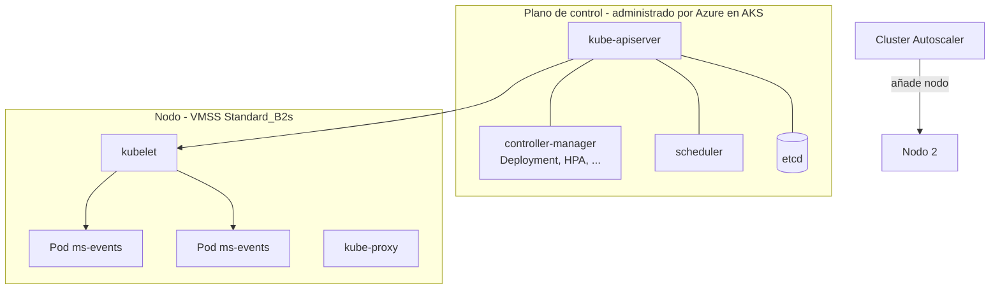

# 05 · Tipos de sistemas de orquestación e implementación de Kubernetes

## 1. ¿Qué es orquestar?
Automatizar el **despliegue, la ubicación, el escalado, la red, la recuperación y la actualización**
de muchas unidades de cómputo (contenedores o VMs) a partir de un **estado deseado declarativo**.
El orquestador compara continuamente el estado deseado con el real y corrige las diferencias
(*reconciliation loop*).

## 2. Tipos de sistemas de orquestación

### 2.1 Por lo que orquestan
| Tipo | Unidad | Ejemplos | Uso en TeamForMe |
|---|---|---|---|
| **De contenedores** | Contenedor / pod | Kubernetes, Docker Swarm, Nomad, Amazon ECS | AKS (MS.Events) |
| **Serverless de contenedores** | Revisión/réplica | Azure Container Apps, Google Cloud Run, AWS Fargate | **Plataforma principal** |
| **De funciones (FaaS)** | Función | Azure Functions, AWS Lambda | — (alternativa para notificaciones) |
| **De infraestructura / IaC** | Recursos cloud | Bicep/ARM, Terraform, Pulumi | `infra/*.bicep` |
| **De configuración** | Estado de servidores | Ansible, Chef, Puppet, cloud-init | `cloud-init` en VM/VMSS |
| **De VMs** | Máquina virtual | VMSS, OpenStack Nova/Heat, VMware vSphere | `vmss.bicep` |
| **De flujos de trabajo** | Tarea/DAG | Apache Airflow, Argo Workflows, Logic Apps, Durable Functions | — |
| **Local / desarrollo** | Contenedor | Docker Compose | `docker-compose.yml` |

### 2.2 Por modelo de control
| Modelo | Descripción | Ejemplo |
|---|---|---|
| Declarativo | Se describe el *qué*; el sistema decide el *cómo* | Kubernetes YAML, Bicep, Compose |
| Imperativo | Se describen los pasos | Scripts `az`, `kubectl run` |
| Centralizado | Un plano de control decide | Kubernetes (API server + scheduler) |
| Descentralizado | Los nodos negocian | Swarm (Raft entre managers), Nomad (gossip) |

### 2.3 Comparativa de orquestadores de contenedores
| | Docker Compose | Docker Swarm | **Kubernetes (AKS)** | **Container Apps** | Nomad |
|---|---|---|---|---|---|
| Multi-nodo | No | Sí | Sí | Sí (administrado) | Sí |
| Autoescalado | No | No nativo | HPA, VPA, Cluster Autoscaler, KEDA | KEDA integrado (incluye 0) | Plugin |
| Curva de aprendizaje | Baja | Baja | Alta | Baja-media | Media |
| Plano de control | — | Propio | Administrado (Free/Standard) | Totalmente oculto | Propio |
| Costo mínimo en Azure | VM | VMs | 1 nodo (~B2s) | 0 (scale to zero) | VMs |
| Control fino | Bajo | Medio | **Total** | Medio | Alto |

**Decisión en TeamForMe:** Container Apps para el sistema completo (costo casi cero, autoescalado
sin operar un clúster) y **AKS para el módulo MS.Events**, para demostrar el control fino de
Kubernetes (HPA con políticas, VPA, PDB, spread, Workload Identity).

## 3. Arquitectura de Kubernetes (resumen)


---

## 4. Implementación: MS.Events en Kubernetes

### 4.1 Estructura (Kustomize)
```text
k8s/ms-events/
├── base/                       # común a todos los clústeres
│   ├── namespace.yaml          # teamforme
│   ├── serviceaccount.yaml     # identidad del pod (Workload Identity en AKS)
│   ├── configmap.yaml          # configuración no sensible
│   ├── deployment.yaml         # pods, probes, recursos, seguridad, spread
│   ├── service.yaml            # ClusterIP :80 -> 8080
│   ├── hpa.yaml                # autoescalado horizontal 2-10
│   ├── pdb.yaml                # minAvailable 1
│   └── kustomization.yaml
├── overlays/
│   ├── local/                  # kind/minikube/Docker Desktop: secreto de desarrollo
│   └── aks/                    # imagen de ACR, Workload Identity, Key Vault, LoadBalancer
└── tools/
    ├── vpa.yaml                # escalado vertical (recomendación)
    └── loadtest-job.yaml       # generador de carga (hey)
```

### 4.2 Decisiones del Deployment
| Campo | Valor | Por qué |
|---|---|---|
| `strategy.rollingUpdate` | `maxSurge 1, maxUnavailable 0` | Despliegue sin caída |
| `resources.requests` | `50m / 96Mi` | Lo que reserva el scheduler: bin packing denso |
| `resources.limits` | `500m / 256Mi` | Techo duro: aislamiento de vecinos ruidosos |
| `startupProbe` | `/health/live`, 30 × 2 s | Tolera arranques lentos sin reinicios |
| `livenessProbe` | `/health/live` c/10 s | Auto-reparación |
| `readinessProbe` | `/health/ready` c/5 s | Fuera del Service si no está listo |
| `topologySpreadConstraints` | `maxSkew 1` por hostname | Réplicas repartidas entre nodos |
| `securityContext` | non-root, `readOnlyRootFilesystem`, `drop ALL`, seccomp | Superficie de ataque mínima |
| Anotaciones `prometheus.io/*` | scrape `:8080/metrics` | Descubrimiento por Prometheus/Azure Monitor |

### 4.3 HPA
CPU 60 % y memoria 75 % (se usa la que pida más réplicas). Scale-up sin ventana (hasta +100 % o
+4 pods cada 15 s); scale-down con ventana de 120 s y −1 pod por minuto.

### 4.4 Key Vault en AKS (Workload Identity)
1. `aks.bicep` habilita `oidcIssuerProfile` y `workloadIdentity`.
2. Crea una *federated credential* en `id-teamforme` para `system:serviceaccount:teamforme:ms-events`.
3. El overlay `aks` anota el ServiceAccount con `azure.workload.identity/client-id` y etiqueta el
   pod con `azure.workload.identity/use: "true"`. El webhook inyecta el token proyectado.
4. `DefaultAzureCredential` del SDK usa ese token: el pod lee Key Vault **sin ningún secreto en el clúster**.

## 5. Probar en local (Docker Desktop Kubernetes, kind o minikube)
```bash
docker build --build-arg SERVICE=MS.Events -t teamforme/ms-events:local microservices
```
```bash
kubectl apply -k k8s/ms-events/overlays/local
```
```bash
kubectl get pods,svc,hpa -n teamforme
```
```bash
kubectl port-forward svc/ms-events 5001:80 -n teamforme
```
Después, `curl localhost:5001/events`. En **kind** antes hay que ejecutar
`kind load docker-image teamforme/ms-events:local`. Para que el HPA tenga métricas en local hay
que instalar metrics-server (Docker Desktop no lo trae):
```bash
kubectl apply -f https://github.com/kubernetes-sigs/metrics-server/releases/latest/download/components.yaml
```
En Docker Desktop además hay que agregar `--kubelet-insecure-tls` a los argumentos del deployment `metrics-server`.

## 6. Desplegar en AKS
```powershell
./scripts/azure/deploy.ps1 -WithAks
```
```powershell
./scripts/azure/deploy-aks.ps1
```
```bash
kubectl get svc ms-events -n teamforme -w
```
Cuando aparezca `EXTERNAL-IP`: `curl http://<EXTERNAL-IP>/events`.

Pausar el clúster para no consumir crédito: `az aks stop -g rg-teamforme -n aks-teamforme`.
