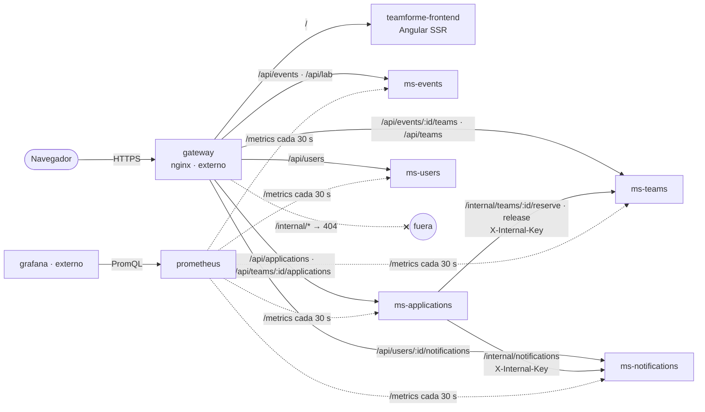
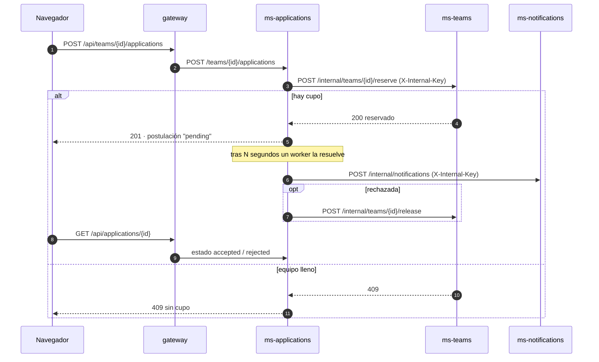
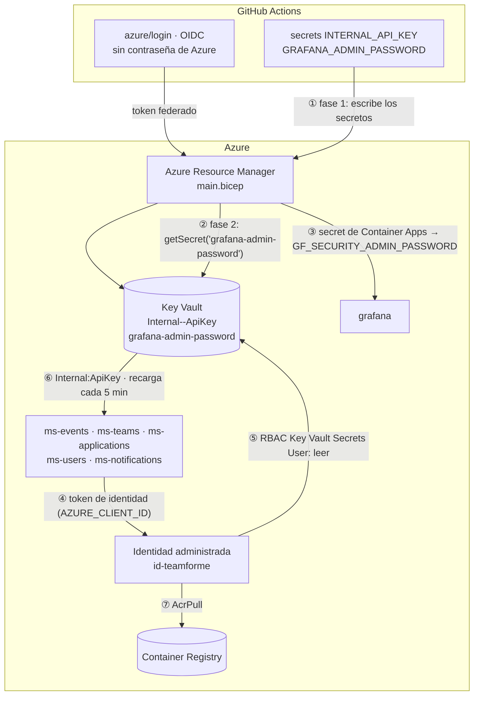

# 08 · Flujo de servicios y de secretos (Azure Key Vault)

Este documento describe qué servicios usa TeamForMe en Azure, cómo viaja una petición entre
ellos y cómo llega cada secreto de **Azure Key Vault** a quien lo necesita.

## 1. Servicios que intervienen

| Servicio | Tipo | Rol | Definido en |
|---|---|---|---|
| Container Apps Environment | Azure (PaaS, express) | Entorno compartido con el frontend; Envoy enruta y balancea | `containerapps.bicep` (`existingEnvironmentName`) |
| `gateway` (nginx) | Container App **externa** | Punto de entrada único: `/api/*` a los microservicios, `/` al frontend | `cloud/gateway/` |
| `teamforme-frontend` | Container App externa (repo TeamForMe) | Angular SSR | repositorio TeamForMe |
| `ms-events`, `ms-teams`, `ms-applications`, `ms-users`, `ms-notifications` | Container Apps **internas** | Lógica de negocio (.NET 10) | `microservices/src/` |
| `prometheus` | Container App interna | Base de datos de series temporales: raspa `/metrics` | `observability/prometheus/` |
| `grafana` | Container App externa | Visualización de métricas | `observability/grafana/` |
| Identidad administrada `id-teamforme` | Microsoft Entra ID | "Cuenta de servicio" de todas las apps: lee Key Vault y descarga de ACR | `identity.bicep` |
| **Key Vault** `kv-teamforme-<sufijo>` | Azure | Secretos `Internal--ApiKey` y `grafana-admin-password`, RBAC | `keyvault.bicep` |
| Container Registry `acrteamforme<sufijo>` | Azure | Imágenes de los contenedores | `registry.bicep` |
| Log Analytics | Azure Monitor | Logs de las Container Apps | `monitoring.bicep` |
| GitHub Actions (OIDC) | CI/CD | Compila, publica y despliega sin contraseñas de Azure | `.github/workflows/` |

## 2. Flujo de una petición

Todo el tráfico va por **HTTPS**, también el interno (`https://<app>.internal.<dominio>`): los
entornos express no admiten `allowInsecure`.

- Las rutas `/internal/*` solo existen entre servicios: el gateway responde 404 a cualquiera
  que las pida desde fuera, y los servicios exigen la cabecera `X-Internal-Key`.
- Envoy (la capa de red de Container Apps) reparte las peticiones entre las réplicas de cada app.

### Postulación a un equipo (flujo principal)

## 3. Flujo de secretos con Key Vault

| # | Qué pasa | Dónde está implementado |
|---|---|---|
| ① | Fase 1 del pipeline: Bicep guarda `Internal--ApiKey` y `grafana-admin-password` en Key Vault. Es el único momento en que los valores salen de GitHub. | `infra.yml` (job *Bicep · fase 1*), `keyvault.bicep` |
| ② | Fase 2: ARM lee `grafana-admin-password` **desde Key Vault** (referencia de despliegue). El vault tiene `enabledForTemplateDeployment: true`. | `main.bicep` (`vault.getSecret(...)`) |
| ③ | El valor se guarda como *secret* de la Container App `grafana` y se inyecta como variable. Grafana no sabe que Key Vault existe. | `containerapps.bicep` (app `grafana`) |
| ④–⑥ | Cada microservicio se autentica con la identidad administrada (`DefaultAzureCredential`) y carga Key Vault como proveedor de configuración: `Internal--ApiKey` → `Internal:ApiKey`. Se vuelve a leer cada 5 min, así que rotar la clave no exige reiniciar. | `KeyVaultConfiguration.cs`, `CloudDefaults.cs`, variables `KeyVault__Uri` y `AZURE_CLIENT_ID` |
| — | Con esa clave, ms-applications firma sus llamadas internas (`X-Internal-Key`) y ms-teams / ms-notifications las validan en cada petición. | `InternalApiKey.cs` |
| ⑦ | La misma identidad descarga las imágenes de ACR: no hay usuario ni contraseña del registro. | `registry.bicep`, `registries[].identity` |

**Permisos (mínimo privilegio):** la identidad de las apps tiene solo *Key Vault Secrets User*
(lectura). Quien despliega tiene *Key Vault Secrets Officer*. La identidad de GitHub tiene
*Contributor* y *RBAC Administrator* sobre el grupo de recursos, y nada más.

**Comprobación:** `GET /api/<servicio>/_info` devuelve `keyVault: true` cuando el servicio tiene
Key Vault configurado (`KeyVault__Uri`). Si no pudiera leerlo, el servicio no arranca (*fail-fast*)
y la réplica no pasa a lista. El smoke test exige `keyVault: true` con `-ExpectKeyVault`.

### Rotar un secreto
| Secreto | Pasos | ¿Hay que reiniciar? |
|---|---|---|
| `Internal--ApiKey` | `az keyvault secret set --vault-name <kv> -n Internal--ApiKey --value <nuevo>` y actualizar el secret `INTERNAL_API_KEY` de GitHub | No: los servicios la recargan en ≤ 5 min (durante ese margen pueden fallar llamadas internas) |
| `grafana-admin-password` | Mismo comando con `-n grafana-admin-password`, y volver a ejecutar *Infra* | Sí: se aplica al volver a desplegar |

## 4. Compatibilidad con entornos express

El backend se despliega en el **mismo** entorno de Container Apps que el frontend, porque Azure
for Students permite un solo entorno por región, y ese entorno es de tipo *express*. Express
rechaza dos opciones que usaba la versión anterior:

| Error de Azure | Causa | Corrección |
|---|---|---|
| `ExpressAllowInsecureNotSupported` | `ingress.allowInsecure: true` en las apps internas | `allowInsecure: false` en todas. Las llamadas internas pasan a `https://<app>.internal.<dominio>` (gateway, `Services__*`, Grafana y Prometheus) |
| `ExpressKeyVaultSecretsNotSupported` | secret de Grafana con `keyVaultUrl` | Referencia de Key Vault **en el despliegue** (`getSecret`) en lugar de en tiempo de ejecución |
| `ExpressMultiRevisionModeNotSupported` | `ms-events` con `activeRevisionsMode: Multiple` | `Single` por defecto. El parámetro `multipleRevisions=true` lo reactiva, pero solo funciona en un entorno estándar; `scripts/azure/canary.ps1` (canary / blue-green) también lo necesita |

Si un intento anterior falló a medias, Azure puede tener una app pendiente de borrar y el
siguiente despliegue recibe `Conflict ... pending delete operation`. Es transitorio: el job
*Bicep · fase 2* de `infra.yml` lo reintenta hasta 3 veces, con 90 s de espera entre intentos.

Prometheus necesita el dominio del entorno para sus *targets*: `containerapps.bicep` le pasa
`INTERNAL_SUFFIX` y `observability/prometheus/entrypoint.sh` genera la configuración al arrancar.
