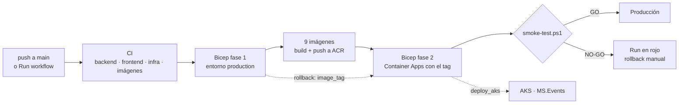

# Despliegue continuo con GitHub Actions

Pipeline que compila, prueba y despliega TeamForMe en Azure en cada push a `main`, sin
contraseñas de Azure guardadas en GitHub (OIDC).

| Archivo | Qué hace |
|---|---|
| [`.github/workflows/ci.yml`](../../../.github/workflows/ci.yml) | CI en cada PR y en ramas que no son `main`: .NET (build + `dotnet test`), Angular (Vitest + build SSR), Bicep, Kustomize y build de las 9 imágenes sin publicarlas |
| [`.github/workflows/deploy.yml`](../../../.github/workflows/deploy.yml) | CD en push a `main` o manual: CI → Bicep fase 1 → imágenes a ACR → Bicep fase 2 → smoke test → (AKS opcional) |
| [`scripts/github/setup-oidc.ps1`](../../../scripts/github/setup-oidc.ps1) | Configuración única: identidad administrada con confianza federada en GitHub + roles + variables y secretos |
| [`scripts/smoke-test.ps1`](../../../scripts/smoke-test.ps1) | Pruebas GO/NO-GO que el pipeline ejecuta contra el gateway desplegado |

## 1. Flujo del pipeline



| Job | Detalle |
|---|---|
| `ci` | Reutiliza `ci.yml` (`workflow_call`). Si falla una prueba, no se despliega nada. |
| `infra` | Única etapa con `environment: production`: si configuras revisores, aquí se aprueba el despliegue. Calcula el tag `yyyyMMddHHmm-<sha7>` y despliega identidad, Key Vault, ACR y Log Analytics. |
| `images` | Matriz de 9 jobs en paralelo con caché de capas de GitHub (`type=gha`). Publica `:<tag>` y `:latest`. Se omite si se lanza con `image_tag` (rollback). |
| `apps` | Verifica que las 9 imágenes del tag existen en ACR y despliega las Container Apps. Escribe las URLs y las revisiones activas en el resumen. |
| `smoke` | Espera hasta 5 min a que la API devuelva JSON y ejecuta `smoke-test.ps1 -ExpectKeyVault`. Publica el log como artefacto. |
| `aks` | Solo si se marca `deploy_aks` al lanzarlo a mano. Ejecuta `scripts/azure/deploy-aks.ps1` con el mismo tag. |

`concurrency: deploy-production` impide dos despliegues simultáneos: el segundo espera al primero.

## 2. Requisito: el sistema completo en un repositorio

Hoy solo `TeamForMeFrontend/` es un repositorio git (`github.com/Carl-Fabri/TeamForMe`). El
pipeline necesita **todo** el directorio `TeamForMe/` en el repositorio (backend, infra, gateway,
scripts y `.github/`). La forma recomendada conserva el historial y el remoto actuales: mover el
`.git` del frontend a la raíz.

> Hazlo cuando tu otra sesión de trabajo no esté a mitad de cambios, y revisa `git status` antes
> del commit.

```powershell
cd C:\laragon\www\TeamForMe
```
```powershell
Move-Item TeamForMeFrontend\.git .git
```
```powershell
git status
```
Git verá los archivos del frontend como "movidos" a `TeamForMeFrontend/` y el resto como nuevos.
Revisa que no aparezcan `.env`, `infra/secrets.local.json`, `bin/` ni `obj/`: el `.gitignore` raíz
los excluye.
```powershell
git add -A
```
```powershell
git commit -m "Monorepo: backend, infraestructura y pipeline de GitHub Actions"
```
```powershell
git push origin HEAD:main
```
Si tu rama principal se llama `master`, renómbrala (`git branch -m master main`) o cambia
`branches: [main]` en `deploy.yml` y el *subject* `ref:refs/heads/main` en `setup-oidc.ps1`.

## 3. Conectar GitHub con Azure (una sola vez)

```powershell
az login
```
```powershell
./scripts/github/setup-oidc.ps1 -Repo Carl-Fabri/TeamForMe
```
El script hace lo siguiente:
1. Crea la identidad administrada `id-github-deployer` en `rg-teamforme`.
2. Le agrega dos credenciales federadas que solo aceptan tokens de **ese repositorio**:
   - `repo:Carl-Fabri/TeamForMe:environment:production`, para el job `infra`.
   - `repo:Carl-Fabri/TeamForMe:ref:refs/heads/main`, para el resto de jobs.
3. Le asigna **Contributor** y **Role Based Access Control Administrator**, solo sobre el grupo de recursos.
4. Imprime los valores que hay que cargar en **GitHub → Settings → Secrets and variables → Actions**:

| Tipo | Nombre | Valor |
|---|---|---|
| Variable | `AZURE_CLIENT_ID` | client id de `id-github-deployer` |
| Variable | `AZURE_TENANT_ID` | tenant de tu cuenta |
| Variable | `AZURE_SUBSCRIPTION_ID` | suscripción Azure for Students |
| Variable | `AZURE_RESOURCE_GROUP` | `rg-teamforme` |
| Variable | `AZURE_LOCATION` | `centralus` (región donde ya funcionó tu Container App) |
| Secret | `INTERNAL_API_KEY` | generado por el script; termina en Key Vault como `Internal--ApiKey` |
| Secret | `GRAFANA_ADMIN_PASSWORD` | generado por el script; termina en Key Vault |

Con `-ConfigureGitHub` el script los carga solo, usando la CLI `gh` (`winget install GitHub.cli`
y `gh auth login`).

Opcional, muy recomendado: **Settings → Environments → production → Required reviewers**. Así
cada despliegue espera tu aprobación antes de tocar Azure.

## 4. Desplegar

- **Automático:** cualquier push a `main` que toque `microservices/`, `TeamForMeFrontend/`,
  `gateway/`, `observability/`, `infra/`, `k8s/`, el smoke test o los workflows.
- **Manual:** **Actions → Deploy · Azure → Run workflow**.
- **Rollback:** **Run workflow** con `image_tag` = un tag anterior (por ejemplo `202611161530-a1b2c3d`).
  No reconstruye imágenes: solo vuelve a apuntar las Container Apps a ese tag. Los tags
  disponibles están en `az acr repository show-tags -n <acr> --repository teamforme/gateway -o table`.
- **Con AKS:** **Run workflow** marcando `deploy_aks`. Recuerda pausar el clúster después
  (`./scripts/azure/costs.ps1 -Action Pause`).

## 5. Dónde ver que todo salió bien

### En GitHub
| Lugar | Qué muestra |
|---|---|
| **Actions → Deploy · Azure → (la ejecución)** | Grafo de jobs con su estado: verde ✓, rojo ✗ u omitido |
| Pestaña **Summary** de la ejecución | Tag desplegado, Key Vault y ACR usados, **URLs** del gateway y Grafana, tabla de **revisiones activas** y salida completa del **smoke test** (GO/NO-GO) |
| Clic en un job → cada paso | Log completo línea a línea, con el comando y su salida (por ejemplo, `az deployment group create`) |
| **Artifacts** al pie de la ejecución | `smoke-test-log` y `backend-test-results` (archivos `.trx` de `dotnet test`), descargables |
| **Environments → production** (barra lateral del repositorio) | Historial de despliegues: qué commit, cuándo y quién lo aprobó |
| Pestaña **Pull requests** | El check "CI" en cada PR: si está en rojo, no conviene fusionar |

Un despliegue está bien hecho cuando **todos los jobs están en verde** y el resumen del smoke
test termina en `GO: 15 pruebas OK`.

### En Azure
| Lugar | Qué muestra |
|---|---|
| Portal → `rg-teamforme` → **Deployments** | `teamforme-base` y `teamforme-apps` con su estado (Succeeded/Failed), duración y cada recurso creado |
| Portal → Container App → **Revisions and replicas** | Revisión nueva por cada tag, tráfico al 100 % en la activa y réplicas en ejecución |
| Portal → Container App → **Log stream** / **Monitoring → Logs** | Logs en vivo / consulta KQL en Log Analytics |
| Portal → Container App → **Metrics** | Requests, Replica Count, CPU y memoria (series temporales de Azure Monitor) |
| Grafana (URL del resumen) | Dashboard *TeamForMe · Microservicios* con datos de Prometheus |
| `<gateway>/api/events/_info` | Versión desplegada (`version` = tag del pipeline) y `keyVault: true` |

## 6. Cómo consultar el estado del despliegue desde la terminal

Son los mismos comandos de solo lectura que usé para revisar el despliegue manual del frontend;
puedes ejecutarlos tú en cualquier momento:

```bash
az account show -o table
```
```bash
az resource list -g rg-teamforme --query "[].{nombre:name, tipo:type, region:location}" -o table
```
```bash
az deployment group list -g rg-teamforme --query "[].{nombre:name, estado:properties.provisioningState, fecha:properties.timestamp}" -o table
```
```bash
az containerapp list -g rg-teamforme --query "[].{app:name, estado:properties.runningStatus, revision:properties.latestRevisionName, url:properties.configuration.ingress.fqdn}" -o table
```
```bash
az containerapp revision list -n gateway -g rg-teamforme -o table
```
```bash
az acr repository show-tags -n <acr> --repository teamforme/gateway -o table
```
```bash
az containerapp logs show -n ms-applications -g rg-teamforme --tail 50
```
Y con la CLI de GitHub (`gh`), para ver las ejecuciones sin abrir el navegador:
```bash
gh run list --workflow deploy.yml
```
```bash
gh run view --log-failed
```

## 7. Convivencia con el despliegue manual actual

En `rg-teamforme` ya existe un despliegue hecho a mano (`teamforme-frontend`, `teamforme-env-cus`,
`acrteamforme93140`). El pipeline crea **recursos con otros nombres** (`cae-teamforme`, `gateway`,
`frontend`, `acrteamforme<sufijo>`…), así que no los modifica ni los borra. Cuando el pipeline
funcione, elimina los recursos manuales para no pagar dos registros:
```bash
az containerapp delete -n teamforme-frontend -g rg-teamforme --yes
```
(y luego los entornos `teamforme-env` y `teamforme-env-cus` y los ACR `acrteamforme93140` y `ca7c45ddbf8aacr`).

## 8. Seguridad del pipeline
- **Sin secretos de Azure en GitHub:** el token OIDC dura minutos y solo se emite para este
  repositorio y para la rama `main` o el entorno `production`.
- **Mínimo privilegio:** la identidad del pipeline solo tiene permisos sobre `rg-teamforme`.
- **Permisos de los workflows:** `contents: read` + `id-token: write`; nada más.
- **Secretos de la aplicación:** `INTERNAL_API_KEY` y `GRAFANA_ADMIN_PASSWORD` solo existen en
  GitHub Secrets y Key Vault. GitHub los oculta (`***`) en los logs.
- **Los pull requests no despliegan:** solo corre la CI, sin acceso a Azure.
