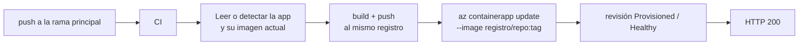

# Despliegue continuo con GitHub Actions

TeamForMe vive en **dos repositorios independientes**, cada uno con su propio pipeline. Un push a
uno despliega solo lo suyo. No hay contraseñas de Azure en GitHub: la autenticación es OIDC con
la identidad administrada `id-github-deployer`.

| Repositorio | Rama | Contenido | Despliega |
|---|---|---|---|
| [Carl-Fabri/TeamForMe](https://github.com/Carl-Fabri/TeamForMe) | `main` | Frontend Angular 21 SSR | La Container App `teamforme-frontend` |
| [Carl-Fabri/TeamForMeBackend](https://github.com/Carl-Fabri/TeamForMeBackend) | `master` | Plantilla gRPC + `cloud/` (microservicios, infra, gateway, observabilidad, k8s, scripts) | Las Container Apps del backend que existan (gateway, ms-*, prometheus, grafana) |

Carpeta de trabajo local (no es un repositorio):
```text
C:\laragon\www\TeamForMe\
├── TeamForMeFrontend\   → Carl-Fabri/TeamForMe
└── TeamForMeBackend\    → Carl-Fabri/TeamForMeBackend
```

## 1. Workflows

### Repositorio TeamForMe (frontend)
| Archivo | Cuándo | Qué hace |
|---|---|---|
| `.github/workflows/ci.yml` | PR y ramas ≠ `main` | `npm ci`, Vitest, build SSR e imagen Docker (sin publicar) |
| `.github/workflows/deploy.yml` | push a `main` (salvo solo `docs/`, `specs/`, `*.md`) o manual | CI → publica la imagen en el registro que ya usa `teamforme-frontend` → `az containerapp update` → espera la revisión → verifica HTTP 200 |

### Repositorio TeamForMeBackend (backend)
| Archivo | Cuándo | Qué hace |
|---|---|---|
| `.github/workflows/ci.yml` | PR y ramas ≠ `master` | Build de la plantilla gRPC, build + `dotnet test` de `cloud/microservices`, Bicep, Kustomize e imágenes del backend (sin publicar) |
| `.github/workflows/deploy.yml` | push a `master` que toque `cloud/microservices`, `cloud/gateway` o `cloud/observability`, o manual | CI → detecta las Container Apps del backend que **ya existen** → build + push al registro de cada una → update → verificación. Si no existe ninguna, termina sin desplegar |
| `.github/workflows/infra.yml` | **Solo manual** | Crea o actualiza la infraestructura completa con Bicep (fases 1 y 2) + smoke test + AKS opcional |

#### Cómo crea `infra.yml` las apps del backend
`infra.yml` lee la Container App del frontend (variable `FRONTEND_APP`, por defecto
`teamforme-frontend`) y le pasa a Bicep dos parámetros de `cloud/infra/main.bicep`:

| Parámetro | Valor que pasa `infra.yml` | Efecto en `containerapps.bicep` |
|---|---|---|
| `frontendUrl` | URL pública de `teamforme-frontend` | No se crea la app `frontend`; el gateway envía `/` a esa URL por HTTPS (con SNI, `proxy_ssl_server_name on` en nginx) |
| `existingEnvironmentName` | El entorno de ese frontend (`teamforme-env-cus`) | Las apps se crean en ese entorno en vez de crear `cae-teamforme`. **Azure for Students permite un solo entorno de Container Apps por región** (error `MaxNumberOfRegionalEnvironmentsInSubExceeded`) |

Con ambos vacíos (por ejemplo, desde `scripts/azure/deploy.ps1`), el Bicep se comporta como antes:
crea su propio entorno y su app `frontend`.

**Entorno "Express".** `teamforme-env-cus` es un entorno de Container Apps de tipo *Express*, que
no admite `ingress.allowInsecure` (`ExpressAllowInsecureNotSupported`) ni secretos con
`keyVaultUrl` (`ExpressKeyVaultSecretsNotSupported`). Al reutilizar un entorno existente, el Bicep
activa un modo compatible (`expressCompatible`):
- Las apps internas solo aceptan HTTPS. El gateway, `ms-applications` y Grafana llaman a los demás
  por `https://<app>.internal.<dominio>`, porque con `http` Azure responde con una redirección y un
  POST redirigido pierde el cuerpo.
- La contraseña de Grafana se pasa como secreto de la app (el mismo valor que está en Key Vault).
- Los microservicios .NET siguen leyendo Key Vault con su SDK y su identidad administrada.
- Limitación conocida: la configuración de Prometheus (`observability/prometheus/prometheus.aca.yml`)
  raspa `http://<app>:80`. Prometheus sigue la redirección a HTTPS, pero si alguna métrica no
  aparece, ese es el primer lugar que revisar.

Verificado con un *what-if* (vista previa sin aplicar cambios) del módulo con tus recursos reales:
crea `gateway`, `grafana`, `prometheus`, `ms-events`, `ms-teams`, `ms-applications`, `ms-users` y
`ms-notifications` en `teamforme-env-cus`, **no** crea una app `frontend` ni otro entorno, y el
gateway queda con `FRONTEND_UPSTREAM=https://teamforme-frontend…azurecontainerapps.io`.

### Flujo de los workflows de despliegue (los dos repositorios)


| Paso | Detalle |
|---|---|
| Detectar | El frontend usa la app de la variable `FRONTEND_APP` (por defecto `teamforme-frontend`). El backend lista las apps del grupo: entra una app si se llama `teamforme-<componente>` o `<componente>` y su imagen viene de un ACR. El registro y el repositorio se toman **de la imagen que la app usa hoy** |
| Build + push | Tag `yyyyMMddHHmm-<sha7>` (más `latest`) en el mismo registro |
| Actualizar | `az containerapp update --image`. La app conserva sus credenciales de registro, ingress, escalado y variables |
| Esperar | Se consulta el estado de la revisión (`provisioningState` y `healthState`), no `latestReadyRevisionName`, que algunas apps devuelven vacío |
| Verificar | Si la app es pública, la URL debe responder 200 |

## 2. Conectar cada repositorio con Azure (una sola vez por repositorio)

La identidad `id-github-deployer` (Central US, roles Contributor y Role Based Access Control
Administrator sobre `rg-teamforme`) es compartida. Cada repositorio necesita sus propias
**credenciales federadas**: el script las agrega en dos formatos de *subject*, por nombre
(`repo:Carl-Fabri/<repo>:…`) y con ID inmutables (`repo:Carl-Fabri@68086080/<repo>@<id>:…`), que
es el que GitHub está enviando.

Desde `TeamForMeBackend\cloud`:
```powershell
az login
```
```powershell
./scripts/github/setup-oidc.ps1 -Repo Carl-Fabri/TeamForMeBackend -Branch master
```
```powershell
./scripts/github/setup-oidc.ps1 -Repo Carl-Fabri/TeamForMe -Branch main
```
El script es idempotente: lo que ya existe se salta. Valida además que `-Location` (por defecto
`centralus`) esté entre las regiones permitidas por la política de Azure for Students
(centralus, mexicocentral, chilecentral, canadacentral, eastus).

En **cada** repositorio de GitHub, en **Settings → Secrets and variables → Actions → Variables**:

| Variable | Valor |
|---|---|
| `AZURE_CLIENT_ID` | `6dfd074e-670d-493d-b66c-96165ef334c9` |
| `AZURE_TENANT_ID` | `c4a66c34-2bb7-451f-8be1-b2c26a430158` |
| `AZURE_SUBSCRIPTION_ID` | `02aca008-ae8e-42ba-996a-54c271eb6d0f` |
| `AZURE_RESOURCE_GROUP` | `rg-teamforme` (opcional, es el valor por defecto) |
| `AZURE_LOCATION` | `centralus` (solo lo usa `infra.yml`) |

Para `infra.yml` del backend, además, en **Secrets**: `INTERNAL_API_KEY` y `GRAFANA_ADMIN_PASSWORD`
(los genera el script).

Y en cada repositorio: **Settings → Environments → New environment → `production`**. Opcional:
**Required reviewers** para aprobar cada despliegue.

## 3. Desplegar
- **Frontend:** push a `main` en `TeamForMeFrontend\`, o **Actions → Deploy · frontend → Run workflow**.
- **Backend:** push a `master` en `TeamForMeBackend\` que toque `cloud/microservices`,
  `cloud/gateway` o `cloud/observability`, o **Actions → Deploy · backend → Run workflow**.
  Mientras no existan las apps del backend en Azure, el workflow termina con el aviso "No hay
  Container Apps del backend".
- **Crear las apps del backend (una vez):** **Actions → Infra · infraestructura completa → Run workflow**
  en la rama `master`. Requiere además, en GitHub, los secrets `INTERNAL_API_KEY` y
  `GRAFANA_ADMIN_PASSWORD` y la variable `AZURE_LOCATION` = `centralus`. Desde entonces, cada push a
  `master` las actualiza con `deploy.yml`.
- **Rollback (cualquier app):**
  ```powershell
  az containerapp update -n <app> -g rg-teamforme --image <registro>/<repositorio>:<tag-anterior>
  ```
  Los tags anteriores: `az acr repository show-tags -n <acr> --repository <repositorio> -o table`.
- **Con AKS:** `infra.yml` marcando `deploy_aks`. Pausa el clúster después
  (`./scripts/azure/costs.ps1 -Action Pause`).

## 4. Dónde ver que todo salió bien

### En GitHub (en cada repositorio)
| Lugar | Qué muestra |
|---|---|
| **Actions → (workflow) → (la ejecución)** | Grafo de jobs con su estado: verde ✓, rojo ✗ u omitido |
| Pestaña **Summary** | Apps detectadas, imagen anterior y nueva, revisión creada, URL y resultado; en `infra.yml`, además, URLs, revisiones activas y el smoke test (GO/NO-GO) |
| Clic en un job → cada paso | Log completo línea a línea, con el comando y su salida |
| **Artifacts** al pie de la ejecución | `test-results` (archivos `.trx` de `dotnet test`) y, en `infra.yml`, `smoke-test-log` |
| **Environments → production** | Historial de despliegues: qué commit, cuándo y quién lo aprobó |
| Pestaña **Pull requests** | El check "CI" en cada PR |

### En Azure
| Lugar | Qué muestra |
|---|---|
| Portal → Container App → **Revisions and replicas** | Revisión nueva por cada despliegue, con el 100 % del tráfico en la activa |
| Portal → ACR → **Repositories** | El tag nuevo de cada imagen |
| Portal → Container App → **Log stream** / **Metrics** | Logs en vivo y series temporales (Requests, Replica Count, CPU, memoria) |
| Portal → `rg-teamforme` → **Deployments** | Solo para `infra.yml`: `teamforme-base` y `teamforme-apps` |

## 5. Comandos de verificación (solo lectura)
```bash
az containerapp list -g rg-teamforme --query "[].{app:name, imagen:properties.template.containers[0].image, revision:properties.latestRevisionName}" -o table
```
```bash
az containerapp revision list -n teamforme-frontend -g rg-teamforme -o table
```
```bash
az identity federated-credential list -g rg-teamforme --identity-name id-github-deployer --query "[].subject" -o tsv
```
```bash
gh run list --repo Carl-Fabri/TeamForMe --workflow deploy.yml
```
```bash
gh run list --repo Carl-Fabri/TeamForMeBackend --workflow deploy.yml
```

## 6. Seguridad
- **Sin secretos de Azure en GitHub:** el token OIDC dura minutos y solo se emite para estos
  repositorios, su rama principal o el entorno `production`.
- **Mínimo privilegio:** la identidad del pipeline solo tiene permisos sobre `rg-teamforme`.
- **Permisos de los workflows:** `contents: read` + `id-token: write`.
- **Secretos de la aplicación:** `INTERNAL_API_KEY` y `GRAFANA_ADMIN_PASSWORD` solo existen en
  GitHub Secrets y Key Vault, y GitHub los oculta (`***`) en los logs.
- **Los pull requests no despliegan:** solo corre la CI, sin acceso a Azure.
