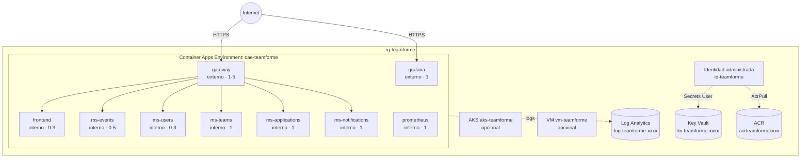

# Documento de lanzamiento · TeamForMe en Azure

| Campo | Valor |
|---|---|
| Producto | TeamForMe: eventos e ideas en búsqueda de grupo, y postulación a esos grupos |
| Versión | `v1.0.0`: backend de microservicios + infraestructura cloud |
| Fecha de preparación | 2026-10-25 |
| Nube | Microsoft Azure, suscripción **Azure for Students** |
| Plataforma principal | Azure Container Apps (Consumption) |
| Módulo en Kubernetes | MS.Events en AKS (opcional) |
| Responsable | Equipo TeamForMe |

## 1. Alcance del lanzamiento

### Incluido
- 5 microservicios .NET 10 (Events, Teams, Applications, Users, Notifications) con contratos
  idénticos a los del frontend.
- API Gateway nginx con enrutamiento `/api/*` y bloqueo de `/internal/*`.
- Frontend Angular 21 SSR en contenedor (aún con la capa mock; la conexión al backend es el siguiente hito).
- **Azure Key Vault** para secretos, con identidad administrada (sin credenciales en el código).
- **Autoescalado**: KEDA HTTP en Container Apps (scale to zero), HPA + VPA + Cluster Autoscaler en AKS, Autoscale en VMSS.
- **Observabilidad**: Prometheus (TSDB) + Grafana con dashboard aprovisionado + Azure Monitor/Log Analytics.
- Infraestructura como código (Bicep) y scripts de despliegue y control de costos.

### Fuera de alcance (siguientes hitos)
| Hito | Descripción |
|---|---|
| H2 | Conectar el frontend (`useMocks: false`, `apiUrl: '/api'`) |
| H3 | Persistencia: Cosmos DB / PostgreSQL Flexible para Teams, Applications y Notifications |
| H4 | Mensajería: Azure Service Bus + worker con escalado KEDA por longitud de cola |
| H5 | Autenticación: Microsoft Entra External ID (OIDC) |
| H6 | CI/CD con GitHub Actions (OIDC hacia Azure, sin secretos) |

## 2. Topología desplegada



### Inventario de recursos
| Recurso | Nombre | SKU / tamaño | Costo estimado |
|---|---|---|---|
| Grupo de recursos | `rg-teamforme` | — | 0 |
| Identidad administrada | `id-teamforme` | — | 0 |
| Key Vault | `kv-teamforme-<sufijo>` | Standard | ~0 (0,03 USD / 10 000 operaciones) |
| Container Registry | `acrteamforme<sufijo>` | Basic | ~5 USD/mes |
| Log Analytics | `log-teamforme-<sufijo>` | PerGB2018, tope 0,5 GB/día | 5 GB/mes gratis |
| Container Apps Environment | `cae-teamforme` | Consumption | 0 |
| Container Apps (9) | gateway, frontend, ms-*, prometheus, grafana | 0,25–0,5 vCPU | grant gratuito; el excedente se paga por segundo |
| AKS (opcional) | `aks-teamforme` | Free tier + 1–2 × B2s | ~1 USD/día encendido |
| VM (opcional) | `vm-teamforme` | B1s + P6 | 0 (free tier 12 meses) |
| VMSS (opcional) | `vmss-teamforme` | 1–3 × B1s | la instancia 1 entra en el free tier si no hay otra B1s |

### Configuración de escalado
| App | Mín | Máx | Regla | CPU / RAM |
|---|---|---|---|---|
| gateway | 1 | 5 | HTTP 30 concurrentes | 0,25 / 0,5Gi |
| frontend | 0 | 3 | HTTP 30 concurrentes | 0,5 / 1Gi |
| ms-events | 0 | 5 | HTTP 30 concurrentes | 0,25 / 0,5Gi |
| ms-users | 0 | 3 | HTTP 30 concurrentes | 0,25 / 0,5Gi |
| ms-teams / ms-applications / ms-notifications | 1 | 1 | — (con estado) | 0,25 / 0,5Gi |
| prometheus / grafana | 1 | 1 | — | 0,25 / 0,5Gi |

## 3. Procedimiento de lanzamiento
Detallado en [GUIA-AZURE-STUDENTS.md](GUIA-AZURE-STUDENTS.md). Resumen:

| # | Paso | Comando | Criterio de éxito |
|---|---|---|---|
| 1 | Prueba local | `docker compose up -d --build` | `/api/events` 200, targets UP en Prometheus |
| 2 | Login | `az login` + `az account set` | Suscripción Azure for Students activa |
| 3 | Despliegue | `./scripts/azure/deploy.ps1` | Script termina e imprime las URLs |
| 4 | Smoke test | ver §4 | Todas las verificaciones en verde |
| 5 | Presupuesto | Portal → Budgets | Alerta configurada |
| 6 | (Opcional) AKS | `deploy.ps1 -WithAks` + `deploy-aks.ps1` | HPA `2/2` y `EXTERNAL-IP` asignada |
| 7 | Comunicación | Compartir las URLs | — |

## 4. Smoke tests post-lanzamiento
| # | Prueba | Esperado | Resultado |
|---|---|---|---|
| 1 | `GET <gateway>/` | Frontend 200 | ☐ |
| 2 | `GET <gateway>/api/events` | 3 eventos | ☐ |
| 3 | `GET <gateway>/api/events/evt-hackcloud-2026/teams` | 4 equipos; `team-stealth` con `members: []` | ☐ |
| 4 | `POST <gateway>/api/teams/team-cloud-cats/applications` | 201 `pending` | ☐ |
| 5 | `GET <gateway>/api/applications/{id}` a los 10 s | `accepted` | ☐ |
| 6 | `POST .../team-pixel-forge/applications` | 409 `team_full` | ☐ |
| 7 | `POST .../team-hard-pass/applications` y esperar | `rejected` y cupo liberado | ☐ |
| 8 | `GET <gateway>/api/users/u-1/notifications` | Notificaciones de 5 y 7 | ☐ |
| 9 | `GET <gateway>/api/events/_info` | `"keyVault": true` | ☐ |
| 10 | `GET <gateway>/api/teams/internal/x` | 404 | ☐ |
| 11 | Grafana con la contraseña de Key Vault | Dashboard con datos | ☐ |
| 12 | Carga con `hey -z 1m -c 200 <gateway>/api/events` | Réplicas de ms-events > 1 | ☐ |

Las pruebas 1–10 están automatizadas en [`scripts/smoke-test.ps1`](../../../scripts/smoke-test.ps1)
(compatible con Windows PowerShell 5.1 y PowerShell 7). El script termina con **GO** (código de
salida 0) o **NO-GO** (código 1), así que también sirve de *gate* en un pipeline de CI/CD.

```powershell
./scripts/smoke-test.ps1
```
```powershell
./scripts/smoke-test.ps1 -BaseUrl https://gateway.<hash>.centralus.azurecontainerapps.io -ExpectKeyVault
```

Ejecución de referencia contra el entorno local (2026-10-26):
```text
[ OK  ] 01 Frontend - HTTP 200
[ OK  ] 02 Catálogo de eventos - 3 eventos
[ OK  ] 03 Equipos privados sin integrantes - 4 equipos, 0 filtraciones
[ OK  ] 04 Postulación creada (pending) - HTTP 201 en team-cloud-cats
[ OK  ] 05 Postulación resuelta (accepted) - estado final: accepted
[ OK  ] 06 Equipo lleno rechazado - HTTP 409 en team-pixel-forge
[ OK  ] 07 Rechazo y cupo liberado - estado: rejected, cupos 1 -> 1
[ OK  ] 08 Notificaciones generadas - 2 notificaciones
[ OK  ] 09 Validación de entrada - HTTP 400
[ OK  ] 10 /internal no expuesto - HTTP 404
[ OK  ] 11 Servicio ms-events ... ms-notifications (5 servicios)
GO: 15 pruebas OK
```
Prueba adicional de concurrencia: 10 postulaciones simultáneas al último cupo de un equipo dieron
1 aceptada y 9 rechazadas con 409, y el equipo quedó en 5/5.

## 5. Monitoreo durante el lanzamiento
| Señal | Dónde | Umbral de alerta |
|---|---|---|
| Servicio caído | Prometheus `ServicioCaido` | `up == 0` durante 1 min |
| Latencia p95 | Grafana / regla `LatenciaAlta` | > 500 ms durante 5 min |
| Errores 5xx | Grafana (panel rojo) | > 0,1/s |
| Cola de postulaciones | `teamforme_applications_pending` | > 50 |
| Réplicas / CPU / memoria | Azure Portal → Container App → Metrics | — |
| Gasto | Cost Management → Budget | 50 / 80 / 100 % |

## 6. Plan de rollback
1. Identificar el tag anterior: `az acr repository show-tags -n <acr> --repository teamforme/gateway -o table`.
2. Volver a desplegar ese tag: `./scripts/azure/deploy.ps1 -SkipImages -ImageTag <tag-anterior>`.
3. Si el fallo es de infraestructura: `az deployment group list -g rg-teamforme` y repetir el
   despliegue desde el commit anterior de `infra/`.
4. En el peor caso: `costs.ps1 -Action Delete` y redesplegar desde cero (≈ 25 min). El estado de
   la v1 está en memoria, así que no hay datos que migrar.

## 7. Riesgos conocidos
| Riesgo | Impacto | Mitigación |
|---|---|---|
| Estado en memoria (Teams/Applications/Notifications) | Se pierde al reiniciar | Datos semilla; H3 (persistencia) |
| Cold start con scale to zero | 2–5 s en la primera petición | `minReplicas: 1` en el gateway; subir a 1 en ms-events si se necesita |
| Agotar el crédito de estudiante | Suspensión de recursos | Presupuesto, `costs.ps1 Pause`, tope de logs |
| Propagación de RBAC de Key Vault | Reinicios durante 1–5 min tras el primer despliegue | Fail-fast + reintento automático de la plataforma |
| Cuota de vCPU de la suscripción | AKS/VM no se crean | Desplegar opcionales por separado |

## 8. Criterios de aceptación (Go / No-Go)
- [ ] `scripts/smoke-test.ps1 -ExpectKeyVault` termina en **GO** contra Azure.
- [ ] Smoke tests 1–11 en verde.
- [ ] Ningún secreto en el repositorio (`infra/secrets.local.json` y `.env` ignorados por git).
- [ ] Dashboard de Grafana con datos de los 5 servicios.
- [ ] Presupuesto configurado.
- [ ] Prueba de escalado (12) observada en las métricas.

## 9. Cronograma de lanzamiento
| Momento | Actividad | Entregable |
|---|---|---|
| **T−7 días** | Congelar el alcance; revisar riesgos (§7); verificar la cuota de vCPU y la región permitida | Alcance cerrado |
| **T−5** | Ensayo completo en local: `docker compose up` + `smoke-test.ps1` | GO local |
| **T−3** | Despliegue en Azure en un grupo de recursos de ensayo (`rg-teamforme-staging`) y prueba de carga | GO en staging + capturas de Grafana |
| **T−2** | Configurar el presupuesto y las alertas; ensayar el rollback (§6) | Rollback probado |
| **T−1** | Eliminar staging; revisión de seguridad (§11); comité Go/No-Go (§8) | Acta de decisión |
| **T0** | Despliegue en `rg-teamforme`; smoke test; anuncio (§13) | URLs públicas |
| **T+1 h** | Vigilancia reforzada: dashboard, logs, réplicas, costo | Sin incidentes P1 |
| **T+1 día** | Revisión de costo real contra lo estimado; ajuste de `minReplicas` | Informe de costos |
| **T+7 días** | Revisión post-lanzamiento (§15) | Lecciones aprendidas y backlog H2–H6 |

## 10. Objetivos de nivel de servicio (SLI / SLO)
| SLI (qué se mide) | Consulta | SLO (objetivo) |
|---|---|---|
| Disponibilidad de la API | `1 - sum(rate(http_requests_received_total{code=~"5.."}[30d])) / sum(rate(http_requests_received_total[30d]))` | ≥ 99,5 % mensual |
| Latencia de lectura | `job:http_request_duration_seconds:p95_5m{job="ms-events"}` | p95 < 300 ms |
| Latencia de postulación | p95 de `POST /teams/{id}/applications` | p95 < 800 ms (incluye la reserva en MS.Teams) |
| Tiempo de resolución | Creada → resuelta | ≤ `ResolveDelaySeconds` + 5 s |
| Integridad del aforo | `max(teamforme_team_seats_filled - teamforme_team_seats_capacity)` | Siempre ≤ 0 |

**Presupuesto de error:** 99,5 % mensual equivale a ~3 h 36 min de indisponibilidad al mes. Si se
consume más del 50 % en una semana, se congelan los cambios nuevos y se priorizan los de estabilidad.

> Con scale to zero, la primera petición tras un periodo sin tráfico tarda 2–5 s. Si el SLO de
> latencia se vuelve crítico, se sube `minReplicas` a 1 en `ms-events` y `frontend` (costo estimado:
> menos de 1 USD por día y por app).

## 11. Checklist de seguridad
| # | Control | Cómo se verifica | Estado |
|---|---|---|---|
| S1 | Sin secretos en el repositorio | `.env` e `infra/secrets.local.json` en `.gitignore`; `git grep -i "apikey\|password"` | ☐ |
| S2 | Secretos solo en Key Vault | `smoke-test.ps1 -ExpectKeyVault` → `keyVault=True` en los 5 servicios | ☐ |
| S3 | Identidades sin contraseña y con mínimo privilegio | La identidad solo tiene *Key Vault Secrets User* y *AcrPull* (`az role assignment list --assignee <principalId>`) | ☐ |
| S4 | API interna protegida | Prueba 10 (404 vía gateway) y 401 sin `X-Internal-Key` | ☐ |
| S5 | Solo el gateway y Grafana son públicos | Resto de las apps con `external: false` (`az containerapp list ... ingress.external`) | ☐ |
| S6 | HTTPS en el borde | Container Apps fuerza HTTPS en el ingress externo | ☐ |
| S7 | Contenedores endurecidos | Usuario no root; en AKS `readOnlyRootFilesystem` y `drop ALL` | ☐ |
| S8 | ACR sin usuario administrador | `adminUserEnabled: false` | ☐ |
| S9 | Contraseña de Grafana distinta de `admin` | Se genera en `secrets.local.json` y se lee de Key Vault | ☐ |
| S10 | SSH de la VM restringido | NSG con origen `<tu IP>/32` y solo autenticación por clave | ☐ |

## 12. Plan de costos del lanzamiento
| Concepto | Supuesto | Estimación mensual |
|---|---|---|
| Container Apps | Dentro del grant gratuito (180 000 vCPU-s, 360 000 GiB-s, 2 M de peticiones) con 6 apps en `min 1` | 0–10 USD (las apps con `min 1` consumen grant 24/7) |
| ACR Basic | Fijo | ~5 USD |
| Log Analytics | Tope de 0,5 GB/día (5 GB/mes gratis) | 0–5 USD |
| Key Vault | Unos pocos miles de operaciones | < 0,10 USD |
| AKS (opcional) | 1 nodo B2s encendido solo durante la demo | ~1 USD/día encendido |
| VM B1s (opcional) | Free tier de estudiante | 0 |
| **Total base** | Sin AKS | **~5–20 USD de los 100 USD de crédito** |

Reglas: presupuesto de 20 USD con alertas al 50/80/100 %; `costs.ps1 -Action Pause` al terminar
cada sesión de demo; revisión diaria en *Cost Management* durante la primera semana.

## 13. Plan de comunicación
| Cuándo | Audiencia | Canal | Mensaje |
|---|---|---|---|
| T−1 | Equipo y docente | Chat del curso | Fecha, URLs previstas, ventana de despliegue y responsable de guardia |
| T0 | Usuarios del piloto | Correo / chat | "TeamForMe está disponible en `<gateway>`", con 3 pasos de uso |
| Incidente | Equipo | Chat | Plantilla: *qué pasa, impacto, quién lo atiende, próxima actualización en 30 min* |
| T+7 | Equipo y docente | Reunión | Resultados de §10 y §12, y lecciones aprendidas |

## 14. Runbook de incidentes
| Síntoma | Diagnóstico | Acción |
|---|---|---|
| El gateway responde 502/504 | `az containerapp logs show -n gateway`; ¿el upstream está en 0 réplicas o reiniciándose? | Reintentar (arranque en frío); `az containerapp revision restart -n <app>`; subir `minReplicas` |
| Alerta `ServicioCaido` | `az containerapp replica list -n <app>`; logs del servicio | Si el error menciona Key Vault: revisar el RBAC (`az role assignment list`) y reiniciar la revisión |
| Postulaciones atascadas en `pending` | `teamforme_applications_pending` creciendo; logs de `ms-applications` (`No se pudo propagar`) | Comprobar `ms-teams` y `ms-notifications`; reiniciar `ms-applications` (se pierde el estado en memoria) |
| `LatenciaAlta` | Panel de CPU por réplica: ¿saturación? | Subir `maxReplicas` o los recursos de la app (vertical) y volver a desplegar |
| Gasto por encima de lo previsto | Cost Management, agrupado por recurso | `costs.ps1 -Action Pause`; revisar `minReplicas` y la ingesta de logs |
| Despliegue defectuoso | Smoke test en NO-GO | Rollback (§6) con `-SkipImages -ImageTag <anterior>` |

Severidades: **P1** sistema caído o postulaciones imposibles (respuesta < 15 min); **P2** degradación
o un servicio caído (< 1 h); **P3** defecto menor (siguiente iteración).

## 15. Revisión post-lanzamiento (T+7)
Preguntas guía, en formato *blameless*:
1. ¿Se cumplieron los SLO de §10? ¿Cuánto presupuesto de error se consumió?
2. ¿Cuál fue el costo real frente al estimado en §12? ¿Qué app consumió más?
3. ¿Cuántas veces escaló cada servicio y con qué carga? (panel "Réplicas activas")
4. ¿Qué incidentes hubo, cuánto se tardó en detectarlos y en resolverlos?
5. ¿Qué paso manual del despliegue conviene automatizar? (candidato: H6 CI/CD)

Salida: actualización del backlog H2–H6 y de los riesgos de §7.
